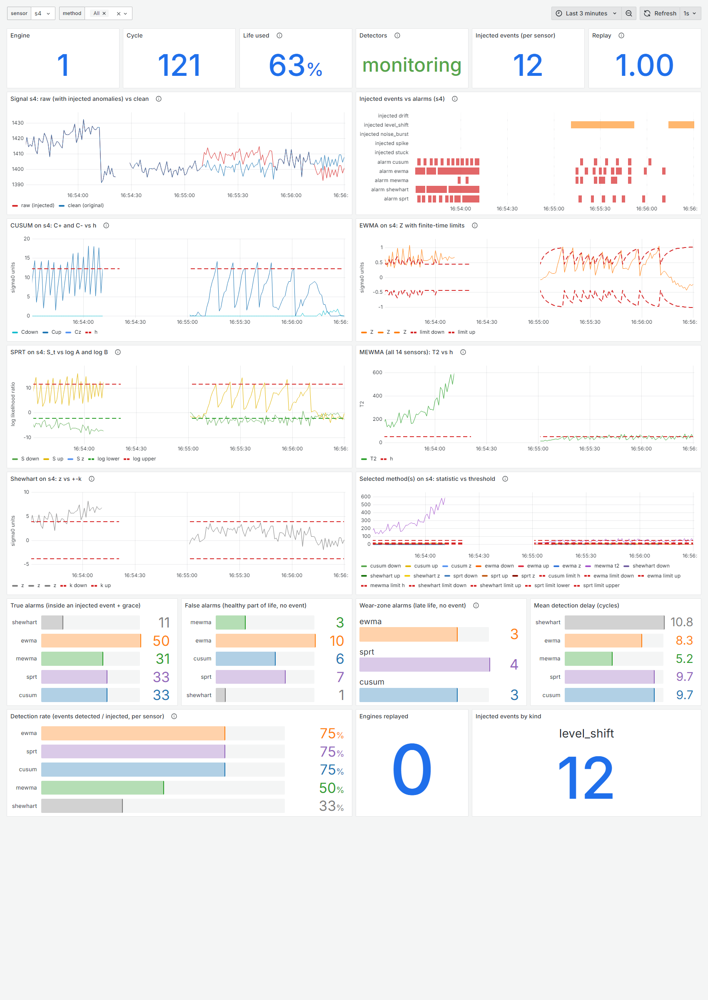
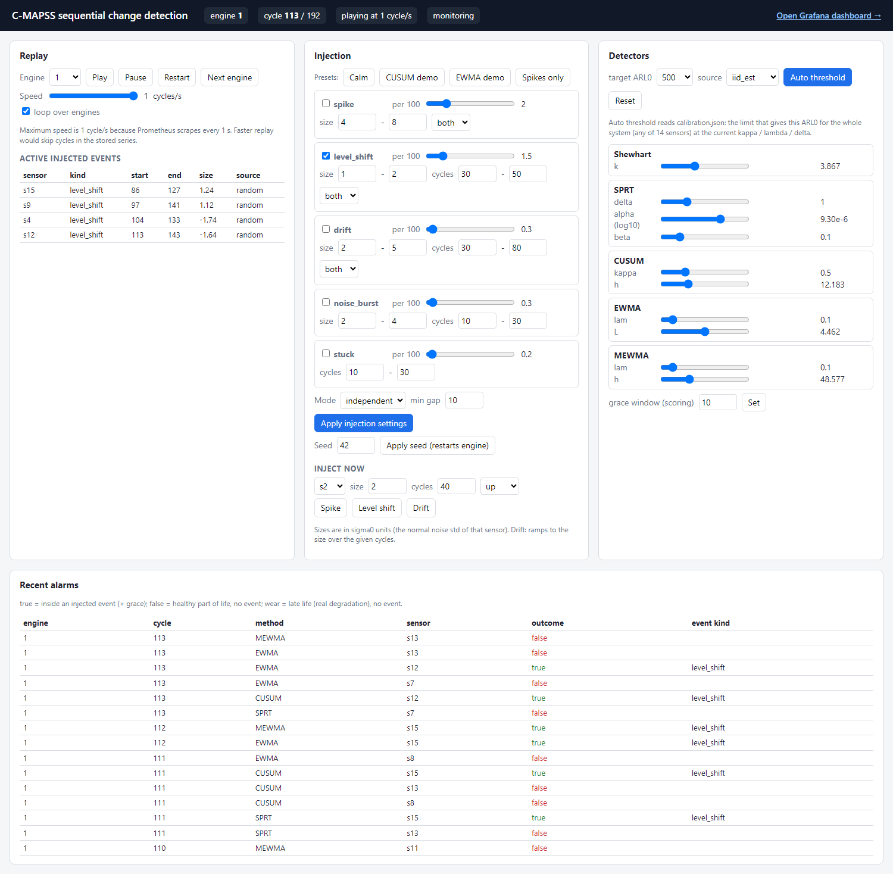
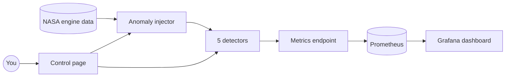

# Sequential change detection on jet engine sensors

How fast can we notice that a sensor signal has changed, without raising false alarms all the time?
This project answers that question on real data from 100 NASA jet engines, and lets you watch it live.

University project for *Mathematical Techniques for Big Data*, topic 6.3 "Sequential change and
anomaly detection" (MSc Data Science, University of Aveiro).



## What it does, in one minute

1. **Real data.** We replay sensor data from 100 turbofan engines (NASA C-MAPSS, FD001). Every engine
   runs until it fails, one reading per flight ("cycle").
2. **Anomalies we control.** We add problems on purpose: single spikes, sudden jumps, slow drifts,
   noisy periods and frozen sensors. Because we add them, we know exactly when and where they are.
3. **Five detectors.** Shewhart, SPRT, CUSUM, EWMA and MEWMA read the data one cycle at a time and
   raise an alarm when they think something changed.
4. **A fair race.** Every detector is tuned to the same false alarm rate (on average one false alarm
   per 500 cycles for the whole engine). Then we measure who finds the real changes first.
5. **Live view.** A web page lets you replay engines, inject anomalies with a button and move the
   detector settings. Grafana draws the signals, the detector statistics and the alarms in real time.

## Quick start

You need **Python 3.10 or newer** ([python.org](https://www.python.org/downloads/)).
For the live dashboard you also need **Docker Desktop** ([docker.com](https://www.docker.com/products/docker-desktop/)).

Open a terminal in this folder and run:

```bash
python run.py setup
```

This creates a private Python environment in `.venv` and installs everything. It takes a few minutes,
only the first time. (Windows: if `python` is not found, type `py` instead of `python`.)

Check that everything works:

```bash
python run.py test
```

You should see `54 passed`. Now pick what you want to do:

| I want to... | command | time | what you get |
|---|---|---|---|
| see the live dashboard | `python run.py docker` | 1 to 3 min the first time | control page on http://localhost:8000, Grafana on http://localhost:3000 |
| try the app without Docker | `python run.py app` | seconds | control page on http://localhost:8000 (no Grafana) |
| reproduce all results | `python run.py evaluate` | about 6 min | `reports/results.md` and the figures in `reports/figures/` |
| recompute the alarm thresholds | `python run.py calibrate` | about 6 min | `calibration.json` and `reports/calibration.md` |
| see what the anomaly injector does | `python run.py injector-demo` | seconds | `out_demo/unit1.png` |

Stop the app or Docker with `Ctrl+C`. `python run.py help` shows all commands and options.
You never need to "activate" the environment: `run.py` finds `.venv` by itself.

## Try the live system in five steps

1. Start Docker Desktop, then run `python run.py docker`. Wait until the log says `Application startup complete`.
2. Open http://localhost:8000. Engine 1 is replayed at one cycle per second. During the first 30 cycles
   the detectors only learn what "normal" looks like.
3. Under **Inject now**, pick sensor `s4`, size `2` and press **Level shift**.
4. Click **Open Grafana dashboard**. A few cycles later the CUSUM curve climbs over its dashed limit,
   and in "Injected events vs alarms" a red alarm bar appears next to the orange event bar.
5. Press the **Spikes only** preset. Shewhart alarms on almost every spike, CUSUM only on some big
   ones. Set **clip |z| at** to `4` and CUSUM goes quiet: a spike is an anomaly, not a change.



A full tour of every button and every panel is in
[docs/STAGE3_parameters_and_ui.md](docs/STAGE3_parameters_and_ui.md), section 8.

## How it works



* The **app** (Python, FastAPI) replays one engine cycle per second, adds the anomalies and runs the
  detectors. It publishes every number on `/metrics`.
* **Prometheus** reads `/metrics` every second and stores the history.
* **Grafana** draws that history as a live dashboard.

## The five detectors, in one line each

All sizes are in σ0, the normal noise level of a sensor. "2 σ0" means "two times the usual wobble".

| method | the idea | best at |
|---|---|---|
| Shewhart | alarm when one reading is far from normal | big jumps; it also flags single spikes |
| SPRT | add up the evidence "changed" against "not changed" until one side wins | a change of a known size |
| CUSUM | an SPRT that restarts at zero and never stops | small changes that last |
| EWMA | a smoothed average with a band around it | slow drifts |
| MEWMA | EWMA on all 14 sensors at once | many sensors moving a little together |

## Main results

All detectors at the same false alarm rate. Full tables and figures: [reports/results.md](reports/results.md).

| test | what happened |
|---|---|
| small jump (1 σ0) | CUSUM finds 77%, SPRT 76%, EWMA 73%, Shewhart only 7% |
| big jump (3 σ0) | all find about 97%; Shewhart is as fast as the others |
| slow drift to 1 σ0 | EWMA with a long memory (λ = 0.05) finds 39%, with a short one (λ = 0.45) 11% |
| all 14 sensors move by 0.3 σ0 | MEWMA finds 55%, CUSUM 13% |
| big single spikes (8 σ0) | Shewhart flags all of them, CUSUM 14%; with clip = 4 CUSUM flags none |
| noisy periods, frozen sensors | mostly missed by all five: they watch the mean, not the noise (an honest limit) |
| real wear, nothing injected | first warning about 120 cycles before the engine fails |

One surprise: the engines start to wear much earlier than expected, at about 30% of their life.
How this changes the thresholds and the false alarm counts is explained in
[docs/STAGE3_parameters_and_ui.md](docs/STAGE3_parameters_and_ui.md), sections 5 and 10.

## What is in this folder

| file or folder | what it is |
|---|---|
| `run.py` | the one command for everything (see Quick start) |
| `detectors/` | the five detectors, one file each, all with the same interface |
| `params.yaml` | every setting, in three groups: scenario, model, hyperparameters |
| `calibrate.py` | finds the alarm thresholds that give the same false alarm rate; writes `calibration.json` |
| `evaluate.py` | runs experiments E1 to E7; writes `reports/` |
| `pipeline.py` | shared code: loads the data and runs a detector over all engines at once |
| `app/` | the live app: replay, control page (`app/static/index.html`) and REST API |
| `docker-compose.yml`, `Dockerfile` | the app, Prometheus and Grafana in containers |
| `prometheus/`, `grafana/` | their settings and the dashboard (`grafana/make_dashboard.py` builds it) |
| `injector.py`, `inject.py`, `cmapss.py`, `config*.yaml`, `plot_injection.py` | the anomaly injector from stage 2 ([docs/INJECTOR.md](docs/INJECTOR.md)) |
| `test_*.py` | 54 automatic tests |
| `data/` | the NASA C-MAPSS FD001 files |
| `reports/` | results, calibration tables, figures (made by the scripts) |
| `docs/` | the full explanation, the injector guide and the screenshots |
| `requirements.txt` | the Python packages (`requirements-lock.txt`: the exact versions used for the results) |

## If something does not work

| problem | what to do |
|---|---|
| `python` is not found | install Python 3.10 or newer; on Windows try `py run.py setup` |
| `Some packages are missing` | run `python run.py setup` |
| `Docker is installed but not running` | start Docker Desktop, wait until it is ready, try again |
| `port is already allocated`, or the page does not open | another program uses the port: `python run.py docker --app-port 8001 --grafana-port 3001 --prometheus-port 9091` |
| Grafana shows old lines from an earlier run | `python run.py docker --fresh` starts with an empty history |
| `evaluate` or `calibrate` seems stuck | they take about 6 minutes each; this is normal |
| the control page says "wait until the baseline window is over" | the first 30 cycles are for learning; inject after cycle 30 |

## More to read

* [docs/STAGE3_parameters_and_ui.md](docs/STAGE3_parameters_and_ui.md): the full explanation. What each
  method is for, every parameter (meaning, default, range, effect), how the thresholds are chosen,
  the UI tour and the honest limits.
* [reports/results.md](reports/results.md): all experiment tables with a short comment each.
* [reports/calibration.md](reports/calibration.md): the threshold calibration.
* [docs/INJECTOR.md](docs/INJECTOR.md): how the anomaly injector works.

## Data

A. Saxena and K. Goebel (2008), "Turbofan Engine Degradation Simulation Data Set",
NASA Ames Prognostics Data Repository. The FD001 files are included in `data/`.
