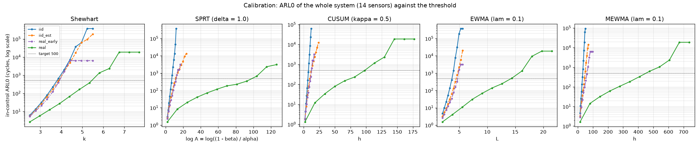
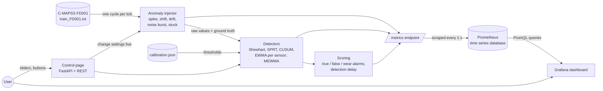

# Stage 3: parameters, hyperparameters and user interface

Topic 6.3, Sequential change and anomaly detection. Data: NASA C-MAPSS FD001 turbofan engines.

This stage answers one question: **how does the detection system work, and how useful is it?** It delivers:

| what was asked | where it is |
|---|---|
| (a) clear definitions of every parameter | sections 3 and 4 of this document, `params.yaml` |
| (b) code that uses them | `detectors/`, `pipeline.py`, `app/` |
| (c) a way to choose them | `calibrate.py` (section 5), `calibration.json` |
| (d) a way to measure usefulness | `evaluate.py` (section 9), `reports/results.md` |
| (e) a user interface to use and show it | control page + Grafana (sections 6 to 8) |

Notation follows the slides: observations X_t, unknown change time ν, density f0 before ν and f1 after it.

---

## 1. The problem in plain words

A turbofan engine has sensors (temperatures, pressures, speeds) that are read once per flight ("cycle").
While the engine is healthy the readings wobble around a stable mean: that wobble is the noise, with
standard deviation **σ0**. At some unknown cycle **ν** something changes: a sensor fault, a leak, a
component that starts to wear. After ν the readings follow a different distribution f1.

A **sequential change detector** reads the data one cycle at a time and must decide, after each new
reading, "has something changed?". Two numbers describe how good it is:

* **ARL0** (average run length under H0): how many cycles it runs, on average, before a **false alarm**
  when nothing has changed. Bigger is better.
* **Detection delay**: how many cycles after ν it takes to raise the alarm when something has changed.
  Smaller is better.

The two pull against each other. A detector that alarms easily is fast but has many false alarms.
Every method below has one **threshold** that sets this trade-off. To compare methods fairly, we give
each one the threshold that produces the **same ARL0** and then compare their delays.

**Anomaly is not change.** A single bad reading (a spike) is an anomaly, but the engine has not changed.
A good change detector should mostly ignore it. A shift that stays is a change. This project measures
the difference (experiment E3).

**Detection is not diagnosis is not adaptation** (concept drift slide). The detectors here only say
"something changed, here, at this cycle". They do not say why (diagnosis) and they do not update the
model of "normal" afterwards (adaptation). Section 10 shows why this matters for these engines.

## 2. The data and the injector

* FD001: 100 engines, one operating condition, each runs until it fails (128 to 362 cycles).
* 14 sensors move: s2 s3 s4 s7 s8 s9 s11 s12 s13 s14 s15 s17 s20 s21. All 14 are monitored.
* The end of every engine's life contains **real wear**, which is a real change.
* The data has no labels, so we **inject** anomalies with known start, end, kind and size
  (`injector.py`, from stage 2). Sizes are in σ0 units, so "2" means "two noise standard deviations" for
  every sensor. Kinds: `spike`, `level_shift`, `drift`, `noise_burst`, `stuck`.

## 3. The methods

All detectors have the same interface (`detectors/base.py`): `reset()`, `update(x, t) -> {statistic,
threshold, alarm, side}`, `params`, `set_params(...)`. They all work on the standardised value

  z_t = (X_t − μ0) / σ0

so every statistic and threshold is in σ0 units, and the same setting works for every sensor.

### 3.1 Shewhart chart (reference baseline)

* **What**: alarm when one reading is far from the mean: |z_t| > k.
* **Why it exists**: the oldest control chart (1920s). It needs no memory and is easy to explain.
* **Where it is used**: factory quality control, simple threshold alarms in every SCADA system.
* **Strength / weakness**: very fast for big jumps, almost blind to small shifts. It also alarms on
  spikes, which is why it is our reference for "anomaly detector, not change detector".

### 3.2 SPRT, Wald's Sequential Probability Ratio Test

* **What**: adds up the evidence for "changed" against "not changed".
  Log likelihood ratio of one reading: ℓ_t = log f1(X_t)/f0(X_t). For f0 = N(μ0, σ0²) and
  f1 = N(μ0 + Δ, σ0²) this is ℓ_t = (Δ/σ0²)(X_t − μ0 − Δ/2), in σ0 units ℓ_t = Δ(z_t − Δ/2).
  Running sum S_t = S_{t−1} + ℓ_t. Wald limits A = (1−β)/α and B = β/(1−α).
  S_t ≥ log A: decide H1 (alarm). S_t ≤ log B: decide H0. Otherwise keep reading.
* **Streaming use**: after H0 the test restarts quietly; after H1 it raises an alarm and restarts.
  Two tests run side by side, one for a shift up and one for a shift down.
* **Why it exists**: for one test it needs the fewest observations, on average, of any test with the same
  error rates (Wald and Wolfowitz).
* **Where it is used**: acceptance sampling, clinical trials, A/B tests with early stopping.
* **Important**: α and β are the errors of **one** test. In streaming use the test is repeated many
  times, so α is not the false alarm rate. Wald's limits are also approximate (they ignore the overshoot
  over the boundary). That is why α is **calibrated** to the target ARL0 instead of chosen directly.

### 3.3 CUSUM (two-sided)

* **What**: C⁺_t = max{0, C⁺_{t−1} + z_t − κ}, C⁻_t = max{0, C⁻_{t−1} − z_t − κ}, C⁺_0 = C⁻_0 = 0.
  Alarm when C⁺_t > h or C⁻_t > h, then both restart at 0.
* **Why it exists**: Page (1954). For a known shift size it is the fastest detector for a given ARL0
  (Lorden, Moustakides).
* **Where it is used**: process monitoring in chemical plants, finance (structural breaks),
  epidemiology (outbreak detection), network intrusion detection.
* **CUSUM is a repeated SPRT.** Multiply C⁺ by Δ and take κ = Δ/2: the update becomes
  S_t = max{0, S_{t−1} + Δ(z_t − Δ/2)}, which is the SPRT sum with its lower boundary log B replaced by
  a reset at 0. Each time the sum falls to 0, a new SPRT starts. So CUSUM and SPRT behave almost the same
  (see E1: their delays agree within one cycle). The unit test `test_cusum_is_repeated_sprt_reset_at_zero`
  checks this identity. The rule κ ≈ Δ/2 comes from here; it is a **heuristic** when the true shift is
  not exactly Δ.

### 3.4 EWMA

* **What**: a smoothed value Z_t = λ z_t + (1−λ) Z_{t−1}, Z_0 = 0 (that is, μ0). Alarm when Z_t leaves
  ± L σ_Z,t with the finite-time standard deviation σ_Z,t = sqrt(λ/(2−λ)·[1−(1−λ)^{2t}]).
  Early limits are narrow (L·λ at t = 1) and widen to L·sqrt(λ/(2−λ)).
* **Irregular time**: when readings are not equally spaced, λ_t = 1 − exp(−ρ Δt). Implemented
  (`rho` > 0); C-MAPSS has one reading per cycle, so it is off by default.
* **Why it exists**: Roberts (1959). It is easy to tune (λ = memory length) and robust to non-normal data.
* **Where it is used**: quality control, smoothing sensor data, risk models (RiskMetrics volatility).
* λ small means long memory: good for small slow drifts. λ = 1 gives the Shewhart chart (tested).

### 3.5 MEWMA (multivariate EWMA)

* **What**: the EWMA on the whole vector of 14 standardised sensors:
  Z_t = λ z_t + (1−λ) Z_{t−1}, Σ_Z,t = λ/(2−λ)[1−(1−λ)^{2t}] Σ, T²_t = Z_tᵀ Σ_Z,t⁻¹ Z_t, alarm when T² > h.
* **Why it exists**: Lowry et al. (1992). When several sensors move a little at the same time, each one
  alone may stay below its limit, but together the evidence is strong.
* **Where it is used**: multi-sensor process monitoring, aircraft engine health monitoring.
* It gives one alarm for the whole engine. As a simple diagnosis the code names the sensor with the largest
  smoothed deviation |Z_j| / sqrt(Σ_jj).

### 3.6 Many sensors: the "any sensor alarms" rule

The four univariate methods run on each of the 14 sensors. The system alarms when **any** sensor alarms.
With p sensors the false alarm rate grows about p times: if each sensor alone had ARL0 = 500, the system
would have ARL0 ≈ 500/14 ≈ 36. So all thresholds are calibrated for the **joint** rule: ARL0 = 500 for the
whole system, which means about 7000 per sensor. MEWMA has one statistic, so its ARL0 is the system ARL0.

## 4. Parameters, in three groups

`params.yaml` holds all of them. There are three kinds:

* **Scenario parameters**: describe the situation. The user sets them.
* **Model parameters**: estimated from the data. Nobody chooses them.
* **Hyperparameters**: chosen and tuned. Thresholds are set by calibration (section 5), not by guessing.

### 4.1 Scenario parameters (set by the user)

| name | slide symbol | plain meaning | default | allowed range | how chosen | larger / smaller |
|---|---|---|---|---|---|---|
| `scenario.data` | X_t | which C-MAPSS file is replayed | `train_FD001.txt` | FD001 (one operating condition) | fixed for this project | - |
| `scenario.sensors` | p | which sensors are monitored | all 14 that move | any subset | all, so MEWMA sees the full engine | more sensors: more coverage, but higher limits for the same ARL0 |
| `scenario.engine` | - | first engine replayed by the app | 1 | 1 to 100 | user | - |
| `loop_engines` | - | go to the next engine at end of life | true | true / false | user | - |
| `replay_speed` | - | cycles replayed per second | 1.0 | 0.05 to 1.0 | user, capped at the scrape rate | faster than 1/s would lose points in Prometheus (section 6.3) |
| injector `seed` | - | random seed of the injected events | 42 | integer | user | same seed = same events |
| injector `mode` | - | each sensor its own events, or one event on all sensors | independent | independent / joint | user | joint is needed to test MEWMA |
| injector `min_gap` | - | clean cycles between two events on one sensor | 10 | ≥ 0 | user | larger: fewer, clearer events |
| `<kind>.enabled` | - | switch an anomaly type on/off | spike, level_shift, drift on | true / false | user | - |
| `<kind>.per_100` | - | expected new events per 100 cycles per sensor | 2 / 0.5 / 0.3 | 0 to 100 | user | larger: more events, more overlap |
| `<kind>.magnitude` | Δ (true shift) | size in σ0 units, drawn from [low, high] | spike 4-8, shift 1-3, drift 2-5 | ≥ 0 (noise_burst ≥ 1) | user | larger: easier to detect |
| `<kind>.duration` | ν to end | event length in cycles, [low, high] | shift 20-60, drift 30-80 | ≥ 1 (shift: null = to end) | user | longer: more time to detect |
| `drift.hold` | - | cycles a drift stays at its final value | 10-30 | ≥ 0 | user | - |
| `<kind>.direction` | sign of Δ | up, down, both (random), wear (physical direction) | both | up / down / both / wear | user | - |
| `scheduled` | ν | fixed events at given cycles | none | list | user, for repeatable demos | - |

### 4.2 Model parameters (estimated from data, NOT chosen)

| name | slide symbol | plain meaning | how it is estimated | value / comment |
|---|---|---|---|---|
| `mu0` | μ0 | normal mean of each sensor | mean of the first `baseline_cycles` cycles of **this** engine | engines start at different levels, so it is per engine |
| `sigma0` | σ0 | normal noise std of each sensor | within-engine std of the baseline windows, pooled over the 100 engines (`fleet_sigma0`) | per engine from only 30 points is ±13% off; the pooled value is stable. Option `engine` exists |
| `cov` | Σ | covariance of the standardised noise (MEWMA) | pooled within-engine covariance of the baseline windows | close to the identity: largest correlation 0.06. The noise of different sensors is almost independent |
| f0, f1 | f0, f1 | SPRT densities | f0 = N(μ0, σ0²), f1 = N(μ0 ± Δσ0, σ0²) | follow from μ0, σ0 and the hyperparameter Δ |
| `wear_direction` | - | does the sensor rise or fall as the engine wears | sign of corr(sensor, life fraction) on the training file | used only by the injector's `wear` direction |

### 4.3 Hyperparameters (chosen and tuned)

Default thresholds come from `calibration.json` (target ARL0 = 500 for the 14-sensor system, source
`iid_est`, see section 5). "Heuristic" marks the places where a rule of thumb is used.

| name | slide symbol | plain meaning | default | allowed range | how chosen | larger / smaller |
|---|---|---|---|---|---|---|
| `baseline_cycles` | - | healthy warm-up used to estimate μ0; detectors start after it | 30 | ≥ 2 (shortest engine 128) | same window the injector keeps clean; checked in E7 | larger: better μ0, later start. Smaller: noisy μ0, many more false alarms (15 cycles: about 9 per 1000 instead of 2) |
| Shewhart `k` | k | alarm when \|z\| > k | **3.87** | > 0 (UI 2 to 7) | **calibrated** to ARL0 | larger: fewer false alarms, misses more shifts |
| SPRT `delta` | Δ | design shift: the size f1 assumes | 1.0 σ0 | > 0 (UI 0.25 to 3) | the smallest shift worth catching | larger: faster on big shifts, slower on small ones |
| SPRT `alpha` | α | type I error of one test; sets log A | **9.3e-6** | (0, 1), α + β < 1 | **calibrated** (Wald's α is per test, not per run, and is approximate) | larger: lower log A, more false alarms |
| SPRT `beta` | β | type II error of one test; sets log B | 0.1 | (0, 1) | heuristic; little effect (E7) | larger: log B closer to 0, the test restarts sooner (more like CUSUM) |
| CUSUM `kappa` | κ | allowance: drift per cycle that is ignored | 0.5 σ0 | ≥ 0 (UI 0 to 2) | **heuristic κ = Δ/2** with Δ = 1 | larger: blind to shifts below κ, faster for big ones. Re-calibrate h after changing it |
| CUSUM `h` | h | decision interval | **12.18** σ0 | > 0 | **calibrated** | larger: fewer false alarms, longer delay |
| EWMA `lam` | λ | weight of the newest reading (memory ≈ 2/λ cycles) | 0.1 | (0, 1] | design choice; E2 compares 0.05 to 0.45 | smaller: long memory, best for small slow drifts. λ = 1 is Shewhart |
| EWMA `L` | L | limit width in std of Z | **4.46** | > 0 (UI 1 to 8) | **calibrated** | larger: fewer false alarms |
| EWMA `rho` | ρ | decay rate for irregular time steps | 0 (off) | ≥ 0 | only if readings are not equally spaced | larger: forgets faster per unit of time |
| MEWMA `lam` | λ | as EWMA, on the 14-vector | 0.1 | (0, 1] | same as EWMA | as EWMA |
| MEWMA `h` | h | limit on T² | **48.6** | > 0 (UI 5 to 150) | **calibrated** | larger: fewer false alarms |
| `restart` | - | what happens after an alarm | reset | reset / continue | reset (slides: restart after each decision) | continue: the statistic keeps growing, one long alarm period counts once |
| `clip` | - | cap \|z\| before updating (robust to spikes) | none | > 0 or none | E3 | 4: spikes no longer trigger CUSUM/EWMA, real shifts still do |
| `alarm_rule` | - | how 14 sensor alarms become one system alarm | any | any | fixed | - |
| `calibration.target_arl0` | ARL0 | wanted average cycles between false alarms (whole system) | 500 | 200, 500, 1000, 2000 | engines live about 200 cycles, so 500 means about one false alarm per 2.5 engine lives | larger: fewer false alarms, slower detection |
| `calibration.source` | - | which data the "auto" thresholds come from | iid_est | iid, iid_est, real_early, real | section 5 | `real` gives very high limits (it treats early wear as noise) |
| `scoring.grace` | - | cycles after an event's end in which an alarm still counts as a detection | 10 | 0 to 100 | scoring choice; E7 | only changes the score, not the detector |
| `scoring.clean_life_fraction` | - | false alarms counted only before this part of life | 0.6 | (0, 1] | as specified; see section 10 | - |

## 5. Calibration: how the thresholds are chosen (`calibrate.py`)

**Rule:** every method gets the threshold (k, α, h, L, h) that gives **the same in-control ARL0**, by
default 500 cycles for the whole 14-sensor system. ARL0 is measured as monitored in-control cycles divided
by the number of alarms, with the detector restarting after each alarm (each restart is a new run).
The search evaluates ARL0 on a grid of thresholds, interpolates log(ARL0), and refines twice. This is done
for a grid of shapes (κ, λ, Δ, β) and four targets, so the app can look up any setting.

**Four sources, same structure** (same 100 engine lengths, same 30-cycle baseline):

| source | data | what it shows |
|---|---|---|
| `iid` | simulated N(0,1) noise, μ0 known | the textbook case |
| `iid_est` | the same noise, μ0 estimated from 30 cycles per engine | the cost of estimating μ0 from few points |
| `real_early` | the real data, cycles 31 to 30% of life | real noise (rounding, tails, dependence), before wear |
| `real` | the real data, cycles 31 to 60% of life | real noise **plus** the start of wear |

Thresholds for ARL0 = 500 (from `reports/calibration.md`):

| method | iid | iid_est | real_early | real (to 60%) | real ARL0 with the iid threshold |
|---|---|---|---|---|---|
| Shewhart k | 3.80 | 3.87 | 3.95 | 5.41 | 22 |
| SPRT α (Δ = 1) | 7.5e-4 | 9.3e-6 | 5.2e-6 | 3.8e-44 | 4 |
| CUSUM h (κ = 0.5) | 7.63 | 12.18 | 12.40 | 98.3 | 4 |
| EWMA L (λ = 0.1) | 3.70 | 4.46 | 4.74 | 14.3 | 4 |
| MEWMA h (λ = 0.1) | 32.5 | 48.6 | 63.0 | 448 | 4 |

What this shows:

1. **Estimating μ0 from 30 cycles matters a lot** (iid → iid_est): CUSUM h goes from 7.6 to 12.2. An error
   of σ0/√30 ≈ 0.18 σ0 in μ0 is a small permanent shift that CUSUM keeps adding up.
2. **The real noise is close to iid** once μ0 is estimated (iid_est ≈ real_early for the univariate
   methods). Lag-1 autocorrelation is at most 0.2 and cross-correlation at most 0.06. MEWMA is the
   exception (h = 63 instead of 48.6): small offsets on 14 sensors add up in T². real_early allows only
   about 6 false alarms in total, so this number is also the least precise one.
3. **The jump to `real` comes from wear, not from noise.** Ending the "healthy" window at 30, 40, 50, 60%
   of life gives CUSUM h = 12, 23, 50, 97. The sensor means have already moved by 0.5 to 1 σ0 between 30%
   and 60% of life. A detector calibrated on that window learns to ignore real wear.
4. Using the textbook (iid) thresholds on the real data gives an ARL0 of 4 cycles instead of 500.
   "Restarts and dependence need calibration": here mostly estimation and slow wear.

**Choice:** the default source is `iid_est`. It matches the healthy real data (`real_early`) and is
20 times more precise (187,580 simulated cycles instead of 3,186 real ones). The `real` thresholds are kept
as an alternative operating point ("only alarm on large changes", see E1 and E6).



## 6. How the system works end to end



### 6.1 One cycle, step by step (`app/live.py`)

1. The replay thread takes the next cycle of the current engine (one row, 14 sensor values).
2. The injector may add an anomaly and records the ground truth (which sensor, which kind).
3. During the first 30 cycles the detectors only collect data; at cycle 30 they compute μ0.
4. After that, every detector updates its statistic and checks its threshold.
5. Each alarm is scored: **true** if the sensor is inside an injected event (+ grace), **wear** if it
   comes after 60% of life with no event, otherwise **false**. The first true alarm of an event gives its
   detection delay.
6. All numbers are written to Prometheus gauges and counters, ready for the next scrape.

### 6.2 What Prometheus and Grafana are, and why they are used

* **Prometheus** is a time series database. Every second it calls `http://app:8000/metrics`, reads the
  current value of every metric, and stores it with a time stamp. It is the standard monitoring tool for
  servers and is free. It is used here because a real deployment would monitor engines the same way:
  the detector publishes numbers, a separate system stores them.
* **Grafana** is a dashboard tool. It asks Prometheus for the stored series (with the PromQL language)
  and draws them. It is used here so that everyone can watch the signals, the detector statistics and the
  alarms live, without writing code. Access is anonymous and read-only.
* Metric names (`/metrics`): `engine_unit`, `engine_cycle`, `engine_life_fraction`, `engine_in_baseline`,
  `sensor_value{sensor, series="raw|clean"}`, `sensor_zscore{sensor}`,
  `detector_statistic{method, sensor, side}`, `detector_threshold{method, sensor, side}`,
  `detector_alarm{method, sensor}` (sensor `any` = system alarm), `injected_event_active{sensor, kind}`,
  counters `detector_alarms_total{method, outcome="true|false|wear"}`, `injected_events_total{kind}`,
  `detected_events_total{method, kind}`, histogram `detection_delay_cycles{method, kind}`.

### 6.3 Why the replay is never faster than 1 cycle per second

Prometheus does not receive every cycle. It **samples** the current values by wall-clock time, once per
scrape interval (1 s). If the app replayed 5 cycles per second, Prometheus would store only every fifth
cycle, and short events (a spike lasts one cycle) and short alarms would disappear from the graphs. So the
replay speed is capped at 1 cycle per scrape interval, and the API rejects faster values with a readable
error. Even at exactly 1 cycle per second the two clocks are not in phase, so a one-cycle flag could fall
between two scrapes. For that reason alarm and spike flags stay on for 2 seconds; the counters are exact.

## 7. How to run it

`run.py` is the single entry point (Python 3.10 or newer; on Windows `py` works instead of `python`):

```bash
python run.py setup        # once: creates .venv and installs the packages
python run.py test         # 54 tests: injector, detectors, app API
python run.py docker       # app + Prometheus + Grafana (needs Docker Desktop running)
python run.py app          # the app alone, without Docker (no Prometheus / Grafana)
python run.py calibrate    # about 6 minutes, writes calibration.json
python run.py evaluate     # about 6 minutes, writes reports/
```

With Docker running:

* Control page: http://localhost:8000
* Grafana: http://localhost:3000 (the dashboard "Sequential change detection" opens as the home page)
* Prometheus: http://localhost:9090 (Status, Targets shows `cmapss_app` as UP)

The plain Docker command works too: `docker compose up --build`. If these ports are taken by another
program: `python run.py docker --app-port 8001 --grafana-port 3001 --prometheus-port 9091`.

The ports are opened on this computer only (127.0.0.1), because the control API has no login.
Prometheus keeps its history in a Docker volume; `python run.py docker --fresh` (or
`docker compose down -v`) starts the next run with an empty history.

## 8. User interface walkthrough

### 8.1 Control page (http://localhost:8000)


**Top bar**: current engine, cycle / total life, playing or paused, and whether the detectors are still
learning μ0 (first 30 cycles) or monitoring. The link opens the Grafana dashboard.

**Replay**
* *Engine* selector: jump to any of the 100 engines (starts from cycle 1).
* *Play / Pause / Restart / Next engine*: control the replay. Restart replays the same engine with the same
  injected events (same seed).
* *Speed*: 0.1 to 1 cycle per second (section 6.3).
* *Loop over engines*: at the end of life, continue with the next engine.
* *Active injected events*: what the injector is doing right now (the ground truth).

**Injection**
* *Presets*: **Calm** (no injection: only real wear), **CUSUM demo** (level shifts of 1 to 2 σ0),
  **EWMA demo** (drifts to 2 to 4 σ0), **Spikes only** (5 spikes per 100 cycles of 5 to 9 σ0).
* Per kind: on/off, *per 100* slider (rate), size range, duration range, direction.
  *Apply injection settings* sends them; they act from the next cycle.
* *Mode*: independent or joint (one event on all sensors at once). *min gap*.
* *Seed*: a new seed rebuilds the injector and restarts the engine.
* *Inject now*: choose a sensor, a size, a length and a direction, then press *Spike*, *Level shift* or
  *Drift*. The event starts at the next cycle. This is the quickest way to show a detection live.

**Detectors**
* One slider per hyperparameter (section 4.3). A change applies at once, without resetting the statistic.
* *target ARL0* and *source*, then **Auto threshold**: sets every method's threshold from
  `calibration.json` for its current κ, λ or Δ. Use it after moving a shape slider: E7 shows that moving
  κ or λ alone mostly changes the false alarm rate. If κ, λ or Δ is outside the calibrated grid
  (for example λ below 0.05), the threshold of the nearest grid value is used and a red warning says so.
* *After an alarm*: reset (the statistic restarts at 0, as on the slides) or continue.
* *Clip |z| at*: limits every reading to ±clip σ0 before SPRT, CUSUM, EWMA and MEWMA use it, so a single
  spike cannot raise an alarm on its own (E3). Shewhart is never clipped. Empty means no clipping.
* *Reset*: all statistics back to 0. *grace window*: changes only the scoring.

**Recent alarms**: the last alarms with engine, cycle, method, sensor and outcome (true / false / wear).

Invalid values (a negative h, a speed above 1, an unknown sensor) are refused with a red message that
says what is wrong, for example `cusum.h = -1.0: must be > 0`.

### 8.2 Grafana dashboard (http://localhost:3000)


At the top choose **sensor** (default s4, the LPT outlet temperature) and **method** (one, several or all).

| panel | what you should see |
|---|---|
| Engine, Cycle, Life used, Detectors, Injected events, Replay | where the replay is |
| Signal: raw vs clean | the red raw line leaves the blue clean line where an anomaly is injected |
| Injected events vs alarms | orange bars: injected events by kind. Red bars: alarms of each method on this sensor. A good method's red bar starts a few cycles after the orange one |
| CUSUM: C⁺ and C⁻ vs h | C⁺ climbs during an upward shift, crosses the dashed h, and drops to 0 (restart) |
| EWMA: Z with finite-time limits | the limits are narrow just after the baseline and widen; Z leaves them during a shift or drift |
| SPRT: S_t vs log A and log B | the sums climb to log A (alarm) during a shift; in normal operation they hit log B and restart |
| MEWMA: T² vs h | one curve for the whole engine; rises when several sensors move together and during wear |
| Shewhart: z vs ±k | single spikes cross ±k; small shifts do not |
| Selected method(s) | the statistic and limit of the methods chosen in the variable |
| True / False / Wear-zone alarms, Mean detection delay, Detection rate | the live score card per method (delay and detection rate leave spikes out: they are anomalies, not changes) |

A good live demonstration: choose the **CUSUM demo** preset or press *Inject now → Level shift* on s4 with
size 2, then watch C⁺ climb in Grafana and the red alarm bar appear next to the orange event bar. Then
choose **Spikes only**: Shewhart alarms on almost every spike and CUSUM on some of the largest ones.
Set *clip |z| at* to 4 and CUSUM goes quiet while Shewhart keeps flagging the spikes.
Late in each engine's life all methods start alarming without any injection: that is real wear.

## 9. How useful is it? (summary of `reports/results.md`)

All methods at the same ARL0 (500 cycles for 14 sensors). "Wear removed" means each engine's slow trend
was subtracted so that only the detectors are measured (section 10 explains why).

* **E1, level shifts.** For small shifts the methods with memory win clearly: a 1 σ0 shift is detected
  77% of the time by CUSUM, 76% by SPRT, 73% by EWMA, but 7% by Shewhart (wear removed; chance level 0 to
  1%). For a 3 σ0 shift all methods detect about 97% and Shewhart is as fast as the others (3 cycles).
  CUSUM and SPRT give the same numbers, as section 3.3 predicts. With the `real` thresholds almost nothing
  below 3 σ0 is detected.
* **E2, drifts.** A small drift needs a small λ: to 1 σ0, λ = 0.05 detects 39% and λ = 0.45 only 11%.
  For large drifts λ hardly matters. Shewhart catches 3% of the 1 σ0 drifts.
* **E3, spikes.** Shewhart flags every 8 σ0 spike (it should: it is an anomaly detector). CUSUM flags 14%
  and EWMA 31%, because one huge reading can cross the limit alone. With `clip = 4` this falls to 0% and 2%,
  while shifts are still found: "anomaly is not change" becomes measurable.
* **E4, noise bursts and stuck sensors.** The honest limit: the mean-based detectors catch only 14 to 18%
  of noise bursts ×2 and 26 to 35% of stuck sensors (Shewhart 71% and 0%). A variance chart (CUSUM on z²
  or on |z_t − z_{t−1}|) for bursts and a run-length rule on zero change for stuck sensors would catch them.
* **E5, joint shifts.** When all 14 sensors move by 0.3 σ0 together, MEWMA detects 55% and "any sensor"
  CUSUM 13%; at 0.5 σ0, 97% against 52%. When only 4 sensors move, MEWMA has no advantage.
* **E6, real wear (the practical value).** With no injection, the first alarm after 30% of life comes a
  median of about 120 cycles before failure (CUSUM, SPRT, EWMA), 126 for MEWMA and 96 for Shewhart.
  About one engine in ten alarms before 30% of life (a false alarm). With the `real` thresholds the
  warning comes later (about 60 cycles before failure) but almost never too early. This is the choice a
  maintenance planner makes: early warning against nuisance alarms.
* **E7, sensitivity.** The thresholds trade detection against false alarms smoothly, with no cliff near the
  defaults. Changing κ or λ without recalibrating mostly moves the false alarm rate, so always press
  *Auto threshold* afterwards. A shorter baseline (15 cycles) multiplies false alarms about 5 times.

## 10. Honest limits

* **Wear starts early.** The task assumed the first 60% of life is healthy. The data says the sensor means
  already move 0.5 to 1 σ0 between 30% and 60% of life. On the raw signal most "false alarms" in that zone
  (about 90 per 1000 cycles against the 2 per 1000 target) are real early wear. We report both the raw
  result and a wear-removed check, and false alarms before 30% of life, which match the target. A model
  that adapts μ0 to slow wear would be the next step (adaptation, in the slide's terms).
* **Short engines.** After the 30-cycle baseline an engine has 98 to 330 cycles. ARL0 = 500 is longer than
  most engines, and with 14 sensors each sensor needs ARL0 ≈ 7000, so very small shifts (0.5 σ0) are rarely
  caught in time.
* **The iid assumption.** The formulas assume independent Gaussian noise. Here the noise is close to that,
  but μ0 is estimated from 30 points and some sensors are coarsely rounded (s17 has 13 distinct values).
  That is why every threshold is calibrated by simulation and checked on real data.
* **Spikes.** Memory-based detectors still react to very large spikes unless `clip` is set.
* **The wear-removed signal is a check, not the real system.** Its trend is fitted on each engine's
  whole life (it looks into the future), and the cubic fit is least accurate at the start of life, where
  it leaves about 5 false alarms per 1000 cycles instead of 2.
* **Noise bursts and stuck sensors** are mostly missed by mean-based detectors (E4).
* **Prometheus time resolution.** Prometheus stores samples by wall-clock time, so the replay is limited to
  1 cycle per second and one-cycle flags are held for 2 seconds. Exact counts come from the counters.
* **Wald's limits are approximate**, and α in streaming use is not a false alarm rate: SPRT's α is found
  by calibration (9.3e-6 for the 14-sensor system; a "natural" choice like α = 0.01 would give far more
  false alarms than the target).
* **Scoring choices** (grace window, life fraction) change the numbers, not the detectors. E7 shows how much.

## 11. Files

| file | what it does |
|---|---|
| `detectors/` | `shewhart.py`, `sprt.py`, `cusum.py`, `ewma.py`, `mewma.py`, shared `base.py` |
| `test_detectors.py`, `test_app.py`, `test_injector.py` | 54 unit tests |
| `params.yaml` | every parameter, in the three groups |
| `pipeline.py` | loads data and parameters, runs detectors over all engines at once |
| `calibrate.py` → `calibration.json`, `reports/calibration.md` | threshold calibration |
| `evaluate.py` → `reports/results.md`, `reports/tables/`, `reports/figures/` | experiments E1 to E7 |
| `app/live.py`, `app/main.py`, `app/static/index.html` | live replay, REST API, control page |
| `docker-compose.yml`, `Dockerfile`, `prometheus/`, `grafana/` | the three services and their configuration |
| `grafana/make_dashboard.py` | builds the dashboard JSON |
| `docs/take_screenshots.py` | the screenshots in this document |
| `run.py` | one command for setup, tests, scripts, app and Docker |
| `docs/INJECTOR.md` | the anomaly injector from stage 2 |
