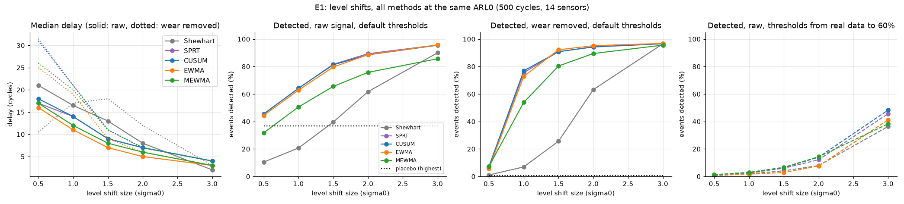
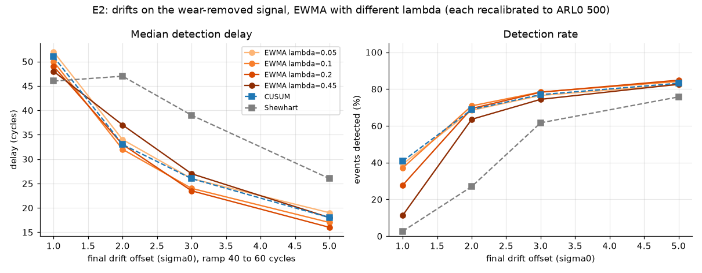
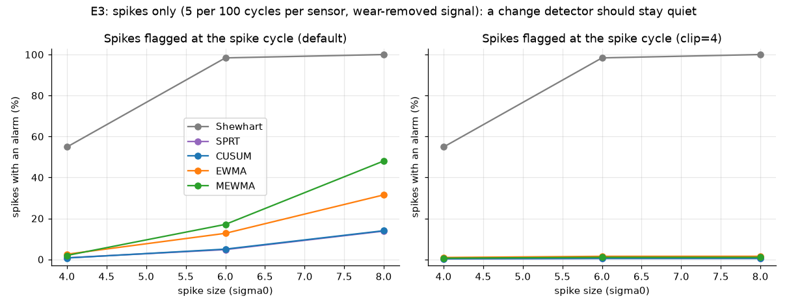
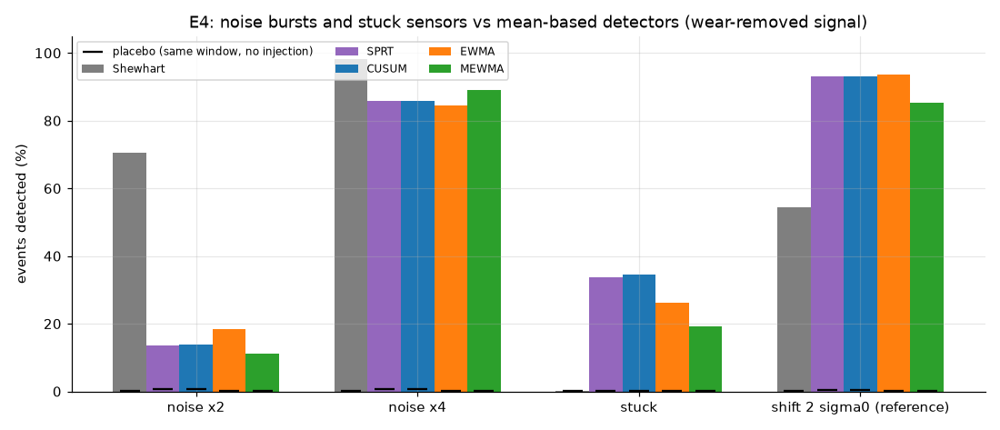
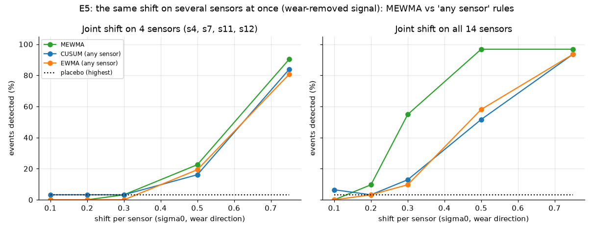
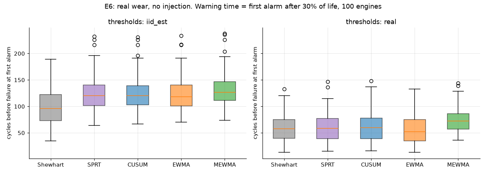
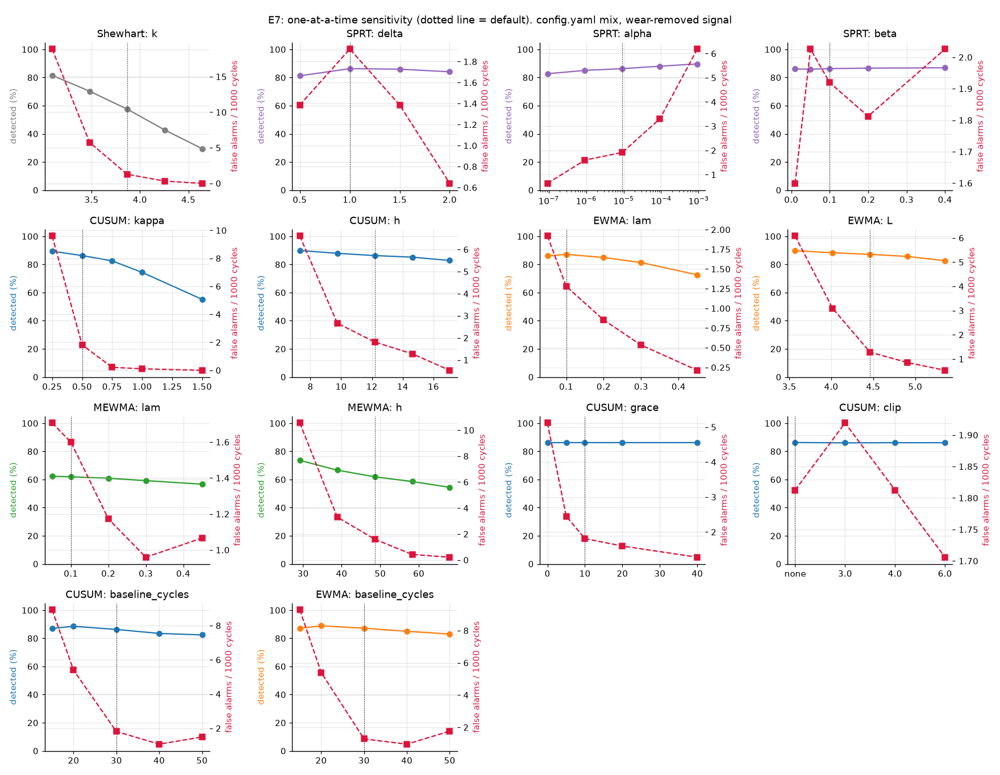

# Stage 3 results: how useful are the detectors?

Generated by `python evaluate.py` (settings in `reports/results_settings.yaml`).

Data: C-MAPSS FD001, 100 engines, 14 sensors. Anomalies are injected only in the healthy part of life (cycles 31 to 60% of life). All methods use thresholds calibrated to the same ARL0 = 500 cycles for the whole system (any of the 14 sensors), source `iid_est`. Grace window 10 cycles.

Columns: `detection_rate` share of events with an alarm in [start, end + grace]; `placebo_rate` the same on the clean signal (chance level); `median_delay`, `mean_delay` in cycles from the event start (detected events only); `fa_per_1000` false alarms per 1000 cycles before 60% of life; `fa_per_1000_early` the same before 30% of life, where the engines show no wear yet; `arl0_emp` = 1000 / fa_per_1000.

Important: in this data slow wear is already visible between 30% and 60% of life (0.5 to 1 sigma0). On the raw signal, alarms there are counted as false alarms, but most are early wear detections. Compare `fa_per_1000_early` (close to the target 2 per 1000) with `fa_per_1000`.

Two signals are therefore used. **raw**: the real data as it is. **wear removed**: for each engine and sensor a smooth cubic trend over the whole life is subtracted (the real noise, rounding and dependence stay). The wear-removed signal measures the detectors themselves (false alarms back at the target); the raw signal shows what happens in practice. E1 shows both, E2 to E5 and E7 use wear removed as the main result (raw rows are in the tables), E6 uses raw data only because there the wear is the target.

## E1 Delay vs level shift size

On the wear-removed signal, a 1 sigma0 shift is detected by CUSUM in 77% of the events, SPRT 76%, EWMA 73%, MEWMA 54%, but Shewhart only 7%: methods with memory win for small shifts. For a 3 sigma0 shift every method detects about 97% and Shewhart is as fast as the others (median 3 cycles, CUSUM 4). CUSUM and SPRT give almost the same numbers, as expected for a repeated SPRT. On the raw signal the same events are partly hidden by early wear: CUSUM detects 64%, but 36% of the windows would contain an alarm even without injection (placebo). On the wear-removed signal the false alarm rate is back near the target (CUSUM 2.0 per 1000 cycles, target 2) and the placebo rate falls to 0%, so most of the false alarms on the raw signal are early wear. With the thresholds calibrated on the real data up to 60% of life (they treat early wear as noise), CUSUM detects only 3% of the 1 sigma0 shifts (EWMA 2%), but its false alarm rate in that zone is 1.9 per 1000 cycles instead of 93.4.

| shift | method | detection_rate | placebo_rate | median_delay | mean_delay | fa_per_1000 | fa_per_1000_early | arl0_emp |
|---|---|---|---|---|---|---|---|---|
| 0.50 | Shewhart | 10% | 8% | 21.0 | 23.4 | 26.9 | 1.9 | 37 |
| 0.50 | SPRT | 46% | 36% | 17.0 | 20.4 | 96.3 | 2.5 | 10 |
| 0.50 | CUSUM | 45% | 36% | 18.0 | 20.3 | 93.5 | 2.5 | 11 |
| 0.50 | EWMA | 44% | 37% | 16.0 | 19.1 | 117.6 | 3.1 | 9 |
| 0.50 | MEWMA | 32% | 25% | 17.0 | 18.9 | 81.4 | 6.3 | 12 |
| 1.00 | Shewhart | 21% | 8% | 16.5 | 19.8 | 26.9 | 1.9 | 37 |
| 1.00 | SPRT | 64% | 36% | 14.0 | 15.2 | 96.0 | 2.2 | 10 |
| 1.00 | CUSUM | 64% | 36% | 14.0 | 15.5 | 93.4 | 2.5 | 11 |
| 1.00 | EWMA | 63% | 37% | 11.0 | 13.6 | 115.6 | 3.1 | 9 |
| 1.00 | MEWMA | 51% | 25% | 12.0 | 14.9 | 62.9 | 6.3 | 16 |
| 1.50 | Shewhart | 40% | 8% | 13.0 | 15.8 | 26.9 | 1.9 | 37 |
| 1.50 | SPRT | 82% | 36% | 9.0 | 10.7 | 96.0 | 2.2 | 10 |
| 1.50 | CUSUM | 81% | 36% | 9.0 | 10.8 | 94.5 | 2.5 | 11 |
| 1.50 | EWMA | 80% | 37% | 7.0 | 9.1 | 115.9 | 3.1 | 9 |
| 1.50 | MEWMA | 66% | 25% | 8.0 | 10.6 | 47.1 | 2.2 | 21 |
| 2.00 | Shewhart | 62% | 8% | 8.0 | 11.5 | 26.9 | 1.9 | 37 |
| 2.00 | SPRT | 89% | 36% | 7.0 | 7.4 | 95.9 | 2.5 | 10 |
| 2.00 | CUSUM | 89% | 36% | 7.0 | 7.3 | 93.6 | 2.5 | 11 |
| 2.00 | EWMA | 89% | 37% | 5.0 | 6.3 | 115.9 | 3.1 | 9 |
| 2.00 | MEWMA | 76% | 25% | 6.0 | 8.5 | 35.3 | 3.1 | 28 |
| 3.00 | Shewhart | 90% | 8% | 2.0 | 4.3 | 26.9 | 1.9 | 37 |
| 3.00 | SPRT | 96% | 36% | 4.0 | 4.2 | 95.6 | 2.5 | 10 |
| 3.00 | CUSUM | 95% | 36% | 4.0 | 4.2 | 92.9 | 2.8 | 11 |
| 3.00 | EWMA | 96% | 37% | 3.0 | 3.5 | 115.4 | 3.1 | 9 |
| 3.00 | MEWMA | 86% | 25% | 3.0 | 5.2 | 18.8 | 1.6 | 53 |

Same settings on the wear-removed signal (each engine's cubic trend subtracted, real noise kept):

| shift | method | detection_rate | placebo_rate | median_delay | mean_delay | fa_per_1000 | fa_per_1000_early | arl0_emp |
|---|---|---|---|---|---|---|---|---|
| 0.50 | Shewhart | 1% | 1% | 10.5 | 16.2 | 1.0 | 2.2 | 1042 |
| 0.50 | SPRT | 7% | 0% | 31.5 | 32.6 | 2.1 | 5.3 | 469 |
| 0.50 | CUSUM | 7% | 0% | 31.0 | 32.2 | 2.0 | 5.0 | 494 |
| 0.50 | EWMA | 6% | 0% | 25.0 | 26.0 | 1.8 | 5.0 | 552 |
| 0.50 | MEWMA | 7% | 0% | 26.0 | 25.7 | 2.2 | 5.6 | 447 |
| 1.00 | Shewhart | 7% | 1% | 17.0 | 20.2 | 1.0 | 2.2 | 1042 |
| 1.00 | SPRT | 76% | 0% | 21.0 | 21.6 | 2.1 | 5.3 | 469 |
| 1.00 | CUSUM | 77% | 0% | 21.0 | 21.4 | 2.0 | 5.0 | 494 |
| 1.00 | EWMA | 73% | 0% | 19.0 | 20.8 | 1.9 | 5.0 | 521 |
| 1.00 | MEWMA | 54% | 0% | 20.0 | 21.0 | 2.3 | 5.6 | 426 |
| 1.50 | Shewhart | 26% | 1% | 18.0 | 20.1 | 1.0 | 2.2 | 1042 |
| 1.50 | SPRT | 91% | 0% | 11.0 | 11.5 | 2.1 | 5.3 | 469 |
| 1.50 | CUSUM | 91% | 0% | 11.0 | 11.4 | 2.1 | 5.0 | 469 |
| 1.50 | EWMA | 92% | 0% | 9.0 | 10.2 | 1.8 | 5.0 | 552 |
| 1.50 | MEWMA | 80% | 0% | 11.0 | 14.0 | 1.9 | 4.4 | 521 |
| 2.00 | Shewhart | 63% | 1% | 12.0 | 15.0 | 1.0 | 2.2 | 1042 |
| 2.00 | SPRT | 94% | 0% | 7.0 | 7.5 | 2.3 | 5.6 | 426 |
| 2.00 | CUSUM | 94% | 0% | 7.0 | 7.4 | 2.0 | 5.0 | 494 |
| 2.00 | EWMA | 95% | 0% | 6.0 | 6.3 | 1.8 | 5.0 | 552 |
| 2.00 | MEWMA | 89% | 0% | 7.0 | 9.6 | 1.4 | 1.6 | 721 |
| 3.00 | Shewhart | 97% | 1% | 3.0 | 4.1 | 1.0 | 2.2 | 1042 |
| 3.00 | SPRT | 97% | 0% | 4.0 | 4.3 | 2.1 | 5.3 | 469 |
| 3.00 | CUSUM | 97% | 0% | 4.0 | 4.2 | 2.0 | 5.0 | 494 |
| 3.00 | EWMA | 97% | 0% | 3.0 | 3.4 | 1.8 | 5.0 | 552 |
| 3.00 | MEWMA | 96% | 0% | 4.0 | 5.3 | 1.2 | 2.5 | 853 |

Same events, thresholds calibrated on the real data up to 60% of life:

| shift | method | detection_rate | median_delay | fa_per_1000 | fa_per_1000_early |
|---|---|---|---|---|---|
| 0.50 | Shewhart | 1% | 2.0 | 1.9 | 0.0 |
| 0.50 | SPRT | 1% | 23.0 | 1.3 | 0.0 |
| 0.50 | CUSUM | 1% | 22.0 | 1.6 | 0.0 |
| 0.50 | EWMA | 1% | 13.0 | 1.4 | 0.0 |
| 0.50 | MEWMA | 1% | 20.5 | 1.3 | 0.0 |
| 1.00 | Shewhart | 2% | 11.0 | 1.9 | 0.0 |
| 1.00 | SPRT | 3% | 23.0 | 1.8 | 0.0 |
| 1.00 | CUSUM | 3% | 27.0 | 1.9 | 0.0 |
| 1.00 | EWMA | 2% | 14.5 | 1.4 | 0.0 |
| 1.00 | MEWMA | 3% | 23.0 | 1.4 | 0.0 |
| 1.50 | Shewhart | 4% | 13.0 | 1.9 | 0.0 |
| 1.50 | SPRT | 6% | 32.0 | 2.1 | 0.0 |
| 1.50 | CUSUM | 6% | 34.0 | 2.6 | 0.0 |
| 1.50 | EWMA | 3% | 16.0 | 1.4 | 0.0 |
| 1.50 | MEWMA | 7% | 29.0 | 1.5 | 0.0 |
| 2.00 | Shewhart | 8% | 18.0 | 1.9 | 0.0 |
| 2.00 | SPRT | 12% | 41.0 | 4.6 | 0.0 |
| 2.00 | CUSUM | 14% | 41.0 | 4.8 | 0.0 |
| 2.00 | EWMA | 8% | 28.0 | 1.4 | 0.0 |
| 2.00 | MEWMA | 14% | 26.0 | 1.6 | 0.0 |
| 3.00 | Shewhart | 36% | 12.0 | 1.9 | 0.0 |
| 3.00 | SPRT | 46% | 35.0 | 3.3 | 0.0 |
| 3.00 | CUSUM | 48% | 34.0 | 3.4 | 0.0 |
| 3.00 | EWMA | 41% | 22.0 | 1.4 | 0.0 |
| 3.00 | MEWMA | 38% | 21.0 | 0.9 | 0.0 |

## E2 Delay vs drift size and EWMA lambda

For a small drift (to 1 sigma0) a small lambda is clearly better: lambda 0.05 detects 39%, lambda 0.45 only 11%. For a large drift (to 5 sigma0) the choice matters little; lambda 0.2 is best (85%, median delay 16 cycles). CUSUM behaves like EWMA with a small lambda (41% at 1 sigma0), while Shewhart is poor on drifts (3% at 1 sigma0, 76% at 5): a drift is small at the start, and only methods with memory add the small steps up.

| signal | drift | method | setting | detection_rate | placebo_rate | median_delay | fa_per_1000 |
|---|---|---|---|---|---|---|---|
| wear removed | 1.00 | EWMA | lambda=0.05 | 39% | 1% | 52.0 | 1.3 |
| wear removed | 1.00 | EWMA | lambda=0.1 | 37% | 1% | 50.0 | 1.6 |
| wear removed | 1.00 | EWMA | lambda=0.2 | 28% | 0% | 49.0 | 1.2 |
| wear removed | 1.00 | EWMA | lambda=0.45 | 11% | 0% | 48.0 | 1.0 |
| wear removed | 1.00 | CUSUM | - | 41% | 1% | 51.0 | 1.3 |
| wear removed | 1.00 | Shewhart | - | 3% | 0% | 46.0 | 1.3 |
| wear removed | 2.00 | EWMA | lambda=0.05 | 68% | 1% | 34.0 | 1.4 |
| wear removed | 2.00 | EWMA | lambda=0.1 | 71% | 1% | 32.0 | 1.6 |
| wear removed | 2.00 | EWMA | lambda=0.2 | 69% | 0% | 33.0 | 1.2 |
| wear removed | 2.00 | EWMA | lambda=0.45 | 64% | 0% | 37.0 | 1.0 |
| wear removed | 2.00 | CUSUM | - | 69% | 1% | 33.0 | 1.4 |
| wear removed | 2.00 | Shewhart | - | 27% | 0% | 47.0 | 1.3 |
| wear removed | 3.00 | EWMA | lambda=0.05 | 76% | 1% | 26.0 | 1.3 |
| wear removed | 3.00 | EWMA | lambda=0.1 | 78% | 1% | 24.0 | 1.6 |
| wear removed | 3.00 | EWMA | lambda=0.2 | 78% | 0% | 23.5 | 1.2 |
| wear removed | 3.00 | EWMA | lambda=0.45 | 74% | 0% | 27.0 | 1.0 |
| wear removed | 3.00 | CUSUM | - | 77% | 1% | 26.0 | 1.5 |
| wear removed | 3.00 | Shewhart | - | 62% | 0% | 39.0 | 1.3 |
| wear removed | 5.00 | EWMA | lambda=0.05 | 82% | 1% | 19.0 | 1.3 |
| wear removed | 5.00 | EWMA | lambda=0.1 | 84% | 1% | 17.0 | 1.6 |
| wear removed | 5.00 | EWMA | lambda=0.2 | 85% | 0% | 16.0 | 1.2 |
| wear removed | 5.00 | EWMA | lambda=0.45 | 83% | 0% | 18.0 | 1.0 |
| wear removed | 5.00 | CUSUM | - | 83% | 1% | 18.0 | 1.2 |
| wear removed | 5.00 | Shewhart | - | 76% | 0% | 26.0 | 1.3 |
| raw | 1.00 | EWMA | lambda=0.05 | 54% | 45% | 27.0 | 93.2 |
| raw | 1.00 | EWMA | lambda=0.1 | 54% | 44% | 27.0 | 99.8 |
| raw | 1.00 | EWMA | lambda=0.2 | 51% | 37% | 28.0 | 90.8 |
| raw | 1.00 | EWMA | lambda=0.45 | 40% | 25% | 33.5 | 63.2 |
| raw | 1.00 | CUSUM | - | 54% | 43% | 29.0 | 80.0 |
| raw | 1.00 | Shewhart | - | 17% | 9% | 38.0 | 23.4 |
| raw | 2.00 | EWMA | lambda=0.05 | 73% | 45% | 26.0 | 91.8 |
| raw | 2.00 | EWMA | lambda=0.1 | 74% | 44% | 25.0 | 99.3 |
| raw | 2.00 | EWMA | lambda=0.2 | 71% | 37% | 25.0 | 90.7 |
| raw | 2.00 | EWMA | lambda=0.45 | 63% | 25% | 29.0 | 63.2 |
| raw | 2.00 | CUSUM | - | 73% | 43% | 26.0 | 78.9 |
| raw | 2.00 | Shewhart | - | 38% | 9% | 39.0 | 23.4 |
| raw | 3.00 | EWMA | lambda=0.05 | 82% | 45% | 23.0 | 92.9 |
| raw | 3.00 | EWMA | lambda=0.1 | 82% | 44% | 21.0 | 99.9 |
| raw | 3.00 | EWMA | lambda=0.2 | 81% | 37% | 21.0 | 90.4 |
| raw | 3.00 | EWMA | lambda=0.45 | 77% | 25% | 24.0 | 63.2 |
| raw | 3.00 | CUSUM | - | 82% | 43% | 23.0 | 79.8 |
| raw | 3.00 | Shewhart | - | 59% | 9% | 34.0 | 23.4 |
| raw | 5.00 | EWMA | lambda=0.05 | 87% | 45% | 17.0 | 93.8 |
| raw | 5.00 | EWMA | lambda=0.1 | 88% | 44% | 16.0 | 99.5 |
| raw | 5.00 | EWMA | lambda=0.2 | 88% | 37% | 15.0 | 90.5 |
| raw | 5.00 | EWMA | lambda=0.45 | 86% | 25% | 17.0 | 63.2 |
| raw | 5.00 | CUSUM | - | 87% | 43% | 17.0 | 80.0 |
| raw | 5.00 | Shewhart | - | 77% | 9% | 24.0 | 23.4 |

## E3 Spikes only: anomaly is not change

For 8 sigma0 spikes Shewhart flags 100% of them: it is an outlier detector, so it should. CUSUM flags 14% and EWMA 31%, because one huge sample can push the statistic over the limit on its own. Clipping z at 4 sigma0 before the update (the clip hyperparameter) brings CUSUM down to 0% and EWMA to 2%, so the 'anomaly is not a change' point becomes measurable: memory-based detectors with a bounded input ignore isolated outliers.

Signal: wear removed (so that the alarm counts are not mixed with wear alarms).

Alarm rate without any injection (per 1000 cycles): Shewhart 1.7, SPRT 2.3, CUSUM 2.2, EWMA 2.2, MEWMA 1.6.

| rate | size | variant | method | spikes | alarms_per_1000 | extra_alarms_per_100_spikes | spikes_flagged |
|---|---|---|---|---|---|---|---|
| 1 | 4 | default | Shewhart | 1312 | 76.3 | 53.4 | 55% |
| 1 | 4 | default | SPRT | 1312 | 2.6 | 0.2 | 0% |
| 1 | 4 | default | CUSUM | 1312 | 2.9 | 0.5 | 0% |
| 1 | 4 | default | EWMA | 1312 | 3.6 | 1.0 | 1% |
| 1 | 4 | default | MEWMA | 1312 | 2.5 | 0.6 | 0% |
| 1 | 4 | clip=4 | Shewhart | 1312 | 76.3 | 53.4 | 55% |
| 1 | 4 | clip=4 | SPRT | 1312 | 2.3 | 0.0 | 0% |
| 1 | 4 | clip=4 | CUSUM | 1312 | 2.6 | 0.2 | 0% |
| 1 | 4 | clip=4 | EWMA | 1312 | 2.6 | 0.2 | 0% |
| 1 | 4 | clip=4 | MEWMA | 1312 | 2.1 | 0.4 | 0% |
| 1 | 6 | default | Shewhart | 1312 | 130.4 | 92.0 | 98% |
| 1 | 6 | default | SPRT | 1312 | 5.2 | 2.1 | 1% |
| 1 | 6 | default | CUSUM | 1312 | 4.7 | 1.8 | 1% |
| 1 | 6 | default | EWMA | 1312 | 12.8 | 7.5 | 7% |
| 1 | 6 | default | MEWMA | 1312 | 7.6 | 4.3 | 4% |
| 1 | 6 | clip=4 | Shewhart | 1312 | 130.4 | 92.0 | 98% |
| 1 | 6 | clip=4 | SPRT | 1312 | 2.6 | 0.2 | 0% |
| 1 | 6 | clip=4 | CUSUM | 1312 | 2.7 | 0.3 | 0% |
| 1 | 6 | clip=4 | EWMA | 1312 | 2.9 | 0.5 | 1% |
| 1 | 6 | clip=4 | MEWMA | 1312 | 2.2 | 0.5 | 0% |
| 1 | 8 | default | Shewhart | 1312 | 132.7 | 93.7 | 100% |
| 1 | 8 | default | SPRT | 1312 | 11.1 | 6.2 | 4% |
| 1 | 8 | default | CUSUM | 1312 | 10.9 | 6.2 | 4% |
| 1 | 8 | default | EWMA | 1312 | 36.3 | 24.3 | 24% |
| 1 | 8 | default | MEWMA | 1312 | 23.9 | 15.9 | 15% |
| 1 | 8 | clip=4 | Shewhart | 1312 | 132.7 | 93.7 | 100% |
| 1 | 8 | clip=4 | SPRT | 1312 | 2.6 | 0.2 | 0% |
| 1 | 8 | clip=4 | CUSUM | 1312 | 2.7 | 0.3 | 0% |
| 1 | 8 | clip=4 | EWMA | 1312 | 2.9 | 0.5 | 1% |
| 1 | 8 | clip=4 | MEWMA | 1312 | 2.2 | 0.5 | 0% |
| 5 | 4 | default | Shewhart | 6559 | 326.0 | 46.4 | 55% |
| 5 | 4 | default | SPRT | 6559 | 11.2 | 1.3 | 1% |
| 5 | 4 | default | CUSUM | 6559 | 9.8 | 1.1 | 1% |
| 5 | 4 | default | EWMA | 6559 | 21.4 | 2.7 | 3% |
| 5 | 4 | default | MEWMA | 6559 | 21.1 | 2.8 | 2% |
| 5 | 4 | clip=4 | Shewhart | 6559 | 326.0 | 46.4 | 55% |
| 5 | 4 | clip=4 | SPRT | 6559 | 6.6 | 0.6 | 0% |
| 5 | 4 | clip=4 | CUSUM | 6559 | 6.0 | 0.5 | 0% |
| 5 | 4 | clip=4 | EWMA | 6559 | 9.5 | 1.0 | 1% |
| 5 | 4 | clip=4 | MEWMA | 6559 | 9.7 | 1.2 | 1% |
| 5 | 6 | default | Shewhart | 6559 | 513.9 | 73.2 | 98% |
| 5 | 6 | default | SPRT | 6559 | 43.2 | 5.8 | 5% |
| 5 | 6 | default | CUSUM | 6559 | 45.4 | 6.2 | 5% |
| 5 | 6 | default | EWMA | 6559 | 91.1 | 12.7 | 13% |
| 5 | 6 | default | MEWMA | 6559 | 133.5 | 18.9 | 17% |
| 5 | 6 | clip=4 | Shewhart | 6559 | 513.9 | 73.2 | 98% |
| 5 | 6 | clip=4 | SPRT | 6559 | 8.7 | 0.9 | 1% |
| 5 | 6 | clip=4 | CUSUM | 6559 | 8.1 | 0.8 | 0% |
| 5 | 6 | clip=4 | EWMA | 6559 | 14.2 | 1.7 | 2% |
| 5 | 6 | clip=4 | MEWMA | 6559 | 13.5 | 1.7 | 1% |
| 5 | 8 | default | Shewhart | 6559 | 519.4 | 74.0 | 100% |
| 5 | 8 | default | SPRT | 6559 | 106.5 | 14.9 | 14% |
| 5 | 8 | default | CUSUM | 6559 | 106.9 | 15.0 | 14% |
| 5 | 8 | default | EWMA | 6559 | 205.9 | 29.1 | 31% |
| 5 | 8 | default | MEWMA | 6559 | 346.3 | 49.3 | 48% |
| 5 | 8 | clip=4 | Shewhart | 6559 | 519.4 | 74.0 | 100% |
| 5 | 8 | clip=4 | SPRT | 6559 | 8.8 | 0.9 | 1% |
| 5 | 8 | clip=4 | CUSUM | 6559 | 8.1 | 0.8 | 0% |
| 5 | 8 | clip=4 | EWMA | 6559 | 14.2 | 1.7 | 2% |
| 5 | 8 | clip=4 | MEWMA | 6559 | 13.5 | 1.7 | 1% |

## E4 Noise bursts and stuck sensors: an honest limit

A stuck sensor is caught by CUSUM in only 35% of the events (Shewhart 0%). The frozen value is just the last noisy reading, so it acts like a level shift of random size, usually below 1 sigma0; when it freezes close to the mean nothing in the mean changes at all. A noise burst x2 keeps the mean unchanged: CUSUM detects 14%, EWMA 18%. Shewhart does better (71%) because wider noise produces extreme single values. A burst x4 is so wide that every method sees it. What would catch them: a variance chart (CUSUM or EWMA on z_t squared, or on |z_t - z_(t-1)|) for noise bursts, and a run-length rule on zero change (for example 5 identical readings in a row) for stuck sensors.

| signal | scenario | method | detection_rate | placebo_rate | median_delay | fa_per_1000 |
|---|---|---|---|---|---|---|
| wear removed | noise x2 | Shewhart | 71% | 0% | 8.0 | 1.5 |
| wear removed | noise x2 | SPRT | 13% | 1% | 16.0 | 1.8 |
| wear removed | noise x2 | CUSUM | 14% | 1% | 17.0 | 1.7 |
| wear removed | noise x2 | EWMA | 18% | 0% | 13.0 | 2.0 |
| wear removed | noise x2 | MEWMA | 11% | 0% | 13.0 | 1.9 |
| raw | noise x2 | Shewhart | 79% | 4% | 7.0 | 30.0 |
| raw | noise x2 | SPRT | 45% | 27% | 13.0 | 102.9 |
| raw | noise x2 | CUSUM | 44% | 28% | 13.0 | 101.3 |
| raw | noise x2 | EWMA | 51% | 30% | 10.0 | 123.9 |
| raw | noise x2 | MEWMA | 54% | 19% | 11.0 | 72.2 |
| wear removed | noise x4 | Shewhart | 98% | 0% | 1.0 | 1.5 |
| wear removed | noise x4 | SPRT | 86% | 1% | 8.0 | 1.6 |
| wear removed | noise x4 | CUSUM | 86% | 1% | 8.0 | 1.6 |
| wear removed | noise x4 | EWMA | 84% | 0% | 7.0 | 2.0 |
| wear removed | noise x4 | MEWMA | 89% | 0% | 6.0 | 1.6 |
| raw | noise x4 | Shewhart | 98% | 4% | 1.0 | 30.0 |
| raw | noise x4 | SPRT | 90% | 27% | 7.0 | 103.3 |
| raw | noise x4 | CUSUM | 89% | 28% | 7.0 | 102.1 |
| raw | noise x4 | EWMA | 90% | 30% | 6.0 | 123.8 |
| raw | noise x4 | MEWMA | 95% | 19% | 4.0 | 29.1 |
| wear removed | stuck | Shewhart | 0% | 0% | 30.0 | 1.5 |
| wear removed | stuck | SPRT | 34% | 0% | 13.0 | 2.1 |
| wear removed | stuck | CUSUM | 35% | 0% | 12.0 | 2.1 |
| wear removed | stuck | EWMA | 26% | 0% | 9.0 | 2.0 |
| wear removed | stuck | MEWMA | 19% | 0% | 10.0 | 2.1 |
| raw | stuck | Shewhart | 2% | 6% | 32.0 | 27.5 |
| raw | stuck | SPRT | 47% | 30% | 10.0 | 98.8 |
| raw | stuck | CUSUM | 47% | 30% | 10.0 | 96.8 |
| raw | stuck | EWMA | 39% | 32% | 8.0 | 121.3 |
| raw | stuck | MEWMA | 25% | 20% | 9.0 | 87.9 |
| wear removed | shift 2 sigma0 (reference) | Shewhart | 54% | 0% | 10.0 | 1.5 |
| wear removed | shift 2 sigma0 (reference) | SPRT | 93% | 0% | 7.0 | 2.2 |
| wear removed | shift 2 sigma0 (reference) | CUSUM | 93% | 0% | 7.0 | 2.0 |
| wear removed | shift 2 sigma0 (reference) | EWMA | 94% | 0% | 6.0 | 2.0 |
| wear removed | shift 2 sigma0 (reference) | MEWMA | 85% | 0% | 7.0 | 1.8 |
| raw | shift 2 sigma0 (reference) | Shewhart | 58% | 6% | 7.0 | 28.6 |
| raw | shift 2 sigma0 (reference) | SPRT | 88% | 29% | 7.0 | 102.4 |
| raw | shift 2 sigma0 (reference) | CUSUM | 88% | 29% | 7.0 | 100.8 |
| raw | shift 2 sigma0 (reference) | EWMA | 88% | 29% | 5.0 | 125.0 |
| raw | shift 2 sigma0 (reference) | MEWMA | 73% | 20% | 6.0 | 44.4 |

## E5 Joint shift on several sensors: MEWMA vs any-sensor CUSUM

With a 0.3 sigma0 shift on all 14 sensors MEWMA detects 55% (median delay 26 cycles), 'any sensor' CUSUM 13% (delay 26). With only 4 of the 14 sensors shifted by 0.3 sigma0: MEWMA 3%, CUSUM 3%. MEWMA adds up evidence over all sensors, so it gains most when many sensors move a little together. On the raw signal (see table) wear alarms fill most windows by chance (placebo rate), so the comparison is only meaningful on the wear-removed signal.

| signal | group | shift | method | detection_rate | placebo_rate | median_delay | fa_per_1000 |
|---|---|---|---|---|---|---|---|
| wear removed | 4 sensors (s4, s7, s11, s12) | 0.10 | MEWMA | 0% | 0% | - | 1.6 |
| wear removed | 4 sensors (s4, s7, s11, s12) | 0.10 | CUSUM | 3% | 3% | 24.0 | 2.0 |
| wear removed | 4 sensors (s4, s7, s11, s12) | 0.10 | EWMA | 0% | 0% | - | 2.2 |
| wear removed | 4 sensors (s4, s7, s11, s12) | 0.20 | MEWMA | 0% | 0% | - | 1.7 |
| wear removed | 4 sensors (s4, s7, s11, s12) | 0.20 | CUSUM | 3% | 3% | 24.0 | 2.0 |
| wear removed | 4 sensors (s4, s7, s11, s12) | 0.20 | EWMA | 0% | 0% | - | 2.2 |
| wear removed | 4 sensors (s4, s7, s11, s12) | 0.30 | MEWMA | 3% | 0% | 6.0 | 1.7 |
| wear removed | 4 sensors (s4, s7, s11, s12) | 0.30 | CUSUM | 3% | 3% | 24.0 | 2.0 |
| wear removed | 4 sensors (s4, s7, s11, s12) | 0.30 | EWMA | 0% | 0% | - | 2.2 |
| wear removed | 4 sensors (s4, s7, s11, s12) | 0.50 | MEWMA | 23% | 0% | 29.0 | 1.7 |
| wear removed | 4 sensors (s4, s7, s11, s12) | 0.50 | CUSUM | 16% | 3% | 25.0 | 2.0 |
| wear removed | 4 sensors (s4, s7, s11, s12) | 0.50 | EWMA | 19% | 0% | 28.0 | 2.2 |
| wear removed | 4 sensors (s4, s7, s11, s12) | 0.75 | MEWMA | 90% | 0% | 17.5 | 1.7 |
| wear removed | 4 sensors (s4, s7, s11, s12) | 0.75 | CUSUM | 84% | 3% | 24.5 | 2.0 |
| wear removed | 4 sensors (s4, s7, s11, s12) | 0.75 | EWMA | 81% | 0% | 21.0 | 2.2 |
| wear removed | all 14 sensors | 0.10 | MEWMA | 0% | 0% | - | 1.6 |
| wear removed | all 14 sensors | 0.10 | CUSUM | 6% | 3% | 29.5 | 2.0 |
| wear removed | all 14 sensors | 0.10 | EWMA | 0% | 0% | - | 2.2 |
| wear removed | all 14 sensors | 0.20 | MEWMA | 10% | 0% | 25.0 | 1.7 |
| wear removed | all 14 sensors | 0.20 | CUSUM | 3% | 3% | 24.0 | 2.0 |
| wear removed | all 14 sensors | 0.20 | EWMA | 3% | 0% | 25.0 | 2.2 |
| wear removed | all 14 sensors | 0.30 | MEWMA | 55% | 0% | 26.0 | 1.6 |
| wear removed | all 14 sensors | 0.30 | CUSUM | 13% | 3% | 25.5 | 2.1 |
| wear removed | all 14 sensors | 0.30 | EWMA | 10% | 0% | 28.0 | 2.2 |
| wear removed | all 14 sensors | 0.50 | MEWMA | 97% | 0% | 11.5 | 1.6 |
| wear removed | all 14 sensors | 0.50 | CUSUM | 52% | 3% | 25.5 | 2.0 |
| wear removed | all 14 sensors | 0.50 | EWMA | 58% | 0% | 23.5 | 2.2 |
| wear removed | all 14 sensors | 0.75 | MEWMA | 97% | 0% | 6.5 | 1.6 |
| wear removed | all 14 sensors | 0.75 | CUSUM | 94% | 3% | 17.0 | 2.0 |
| wear removed | all 14 sensors | 0.75 | EWMA | 94% | 0% | 16.0 | 2.2 |
| raw | 4 sensors (s4, s7, s11, s12) | 0.10 | MEWMA | 100% | 100% | 5.0 | 112.6 |
| raw | 4 sensors (s4, s7, s11, s12) | 0.10 | CUSUM | 94% | 90% | 8.0 | 113.6 |
| raw | 4 sensors (s4, s7, s11, s12) | 0.10 | EWMA | 94% | 94% | 11.0 | 137.6 |
| raw | 4 sensors (s4, s7, s11, s12) | 0.20 | MEWMA | 100% | 100% | 5.0 | 112.6 |
| raw | 4 sensors (s4, s7, s11, s12) | 0.20 | CUSUM | 94% | 90% | 9.0 | 114.9 |
| raw | 4 sensors (s4, s7, s11, s12) | 0.20 | EWMA | 97% | 94% | 11.0 | 137.9 |
| raw | 4 sensors (s4, s7, s11, s12) | 0.30 | MEWMA | 100% | 100% | 4.0 | 112.6 |
| raw | 4 sensors (s4, s7, s11, s12) | 0.30 | CUSUM | 97% | 90% | 8.5 | 113.8 |
| raw | 4 sensors (s4, s7, s11, s12) | 0.30 | EWMA | 100% | 94% | 11.0 | 137.9 |
| raw | 4 sensors (s4, s7, s11, s12) | 0.50 | MEWMA | 100% | 100% | 4.0 | 112.7 |
| raw | 4 sensors (s4, s7, s11, s12) | 0.50 | CUSUM | 97% | 90% | 8.0 | 115.2 |
| raw | 4 sensors (s4, s7, s11, s12) | 0.50 | EWMA | 100% | 94% | 8.0 | 137.2 |
| raw | 4 sensors (s4, s7, s11, s12) | 0.75 | MEWMA | 100% | 100% | 3.0 | 112.6 |
| raw | 4 sensors (s4, s7, s11, s12) | 0.75 | CUSUM | 100% | 90% | 6.0 | 114.1 |
| raw | 4 sensors (s4, s7, s11, s12) | 0.75 | EWMA | 100% | 94% | 6.0 | 137.9 |
| raw | all 14 sensors | 0.10 | MEWMA | 100% | 100% | 5.0 | 112.6 |
| raw | all 14 sensors | 0.10 | CUSUM | 97% | 90% | 7.5 | 114.4 |
| raw | all 14 sensors | 0.10 | EWMA | 94% | 94% | 9.0 | 137.4 |
| raw | all 14 sensors | 0.20 | MEWMA | 100% | 100% | 4.0 | 112.5 |
| raw | all 14 sensors | 0.20 | CUSUM | 100% | 90% | 8.0 | 114.6 |
| raw | all 14 sensors | 0.20 | EWMA | 100% | 94% | 9.0 | 137.8 |
| raw | all 14 sensors | 0.30 | MEWMA | 100% | 100% | 3.0 | 112.6 |
| raw | all 14 sensors | 0.30 | CUSUM | 100% | 90% | 7.0 | 115.2 |
| raw | all 14 sensors | 0.30 | EWMA | 100% | 94% | 6.0 | 137.9 |
| raw | all 14 sensors | 0.50 | MEWMA | 100% | 100% | 2.0 | 112.6 |
| raw | all 14 sensors | 0.50 | CUSUM | 100% | 90% | 4.0 | 115.7 |
| raw | all 14 sensors | 0.50 | EWMA | 100% | 94% | 4.0 | 136.9 |
| raw | all 14 sensors | 0.75 | MEWMA | 100% | 100% | 1.0 | 112.6 |
| raw | all 14 sensors | 0.75 | CUSUM | 100% | 90% | 4.0 | 114.5 |
| raw | all 14 sensors | 0.75 | EWMA | 100% | 94% | 3.0 | 138.2 |

## E6 Real wear, no injection: early warning before failure

With the default thresholds CUSUM warns a median 120 cycles before failure (EWMA 118, MEWMA 126, Shewhart 96); FD001 engines live 128 to 362 cycles. With the 'real' thresholds (early wear treated as noise) the warning comes later: CUSUM 60 cycles, with fewer early alarms (0% vs 9% of engines alarm before 30% of life). This is the trade-off a maintenance planner has to choose.

| variant | method | engines_alarmed | first_before_early | median_rul_first | median_rul_after_early | p10_rul_after_early | median_alarms |
|---|---|---|---|---|---|---|---|
| iid_est | Shewhart | 100% | 8% | 100 | 96 | 62 | 68 |
| iid_est | SPRT | 100% | 7% | 120 | 120 | 84 | 82 |
| iid_est | CUSUM | 100% | 9% | 121 | 120 | 84 | 82 |
| iid_est | EWMA | 100% | 10% | 118 | 118 | 83 | 92 |
| iid_est | MEWMA | 100% | 19% | 130 | 126 | 89 | 86 |
| real | Shewhart | 100% | 0% | 58 | 58 | 30 | 41 |
| real | SPRT | 100% | 0% | 58 | 58 | 29 | 20 |
| real | CUSUM | 100% | 0% | 60 | 60 | 30 | 21 |
| real | EWMA | 100% | 0% | 52 | 52 | 26 | 33 |
| real | MEWMA | 100% | 0% | 72 | 72 | 48 | 28 |

first_before_early = share of engines whose first alarm comes before 30% of life (most likely a false alarm). p10 = 10% of the engines get less warning than this.

## E7 Sensitivity of each hyperparameter

Thresholds trade detection against false alarms directly: CUSUM h from 7.3 to 17.1 moves detection from 90% to 83% and false alarms from 6.6 to 0.5 per 1000 cycles. Changing a shape parameter without recalibrating the threshold mostly changes the false alarm rate (CUSUM kappa 0.25: 9.6, kappa 1.5: 0.0 per 1000): always recalibrate h (the app's auto threshold button) after moving kappa or lambda. The grace window only changes the scoring, not the detector: a short grace counts late alarms of long events as false alarms.

| method | parameter | value_s | default_s | detection_rate | mean_delay | fa_per_1000 | spikes_flagged |
|---|---|---|---|---|---|---|---|
| Shewhart | k | 3.09 |  | 82% | 11.9 | 18.9 | 97% |
| Shewhart | k | 3.48 |  | 70% | 15.7 | 5.8 | 95% |
| Shewhart | k | 3.87 | yes | 58% | 19.6 | 1.3 | 91% |
| Shewhart | k | 4.25 |  | 43% | 23.7 | 0.3 | 86% |
| Shewhart | k | 4.64 |  | 29% | 28.9 | 0.0 | 80% |
| SPRT | delta | 0.5 |  | 81% | 18.0 | 1.4 | 0% |
| SPRT | delta | 1 | yes | 86% | 13.1 | 1.9 | 2% |
| SPRT | delta | 1.5 |  | 86% | 12.5 | 1.4 | 10% |
| SPRT | delta | 2 |  | 84% | 12.8 | 0.6 | 31% |
| SPRT | alpha | 0.00093 |  | 90% | 9.5 | 6.2 | 22% |
| SPRT | alpha | 9.3e-05 |  | 88% | 11.5 | 3.3 | 6% |
| SPRT | alpha | 9.3e-06 | yes | 86% | 13.1 | 1.9 | 2% |
| SPRT | alpha | 9.3e-07 |  | 85% | 14.8 | 1.6 | 1% |
| SPRT | alpha | 9.3e-08 |  | 83% | 16.5 | 0.6 | 1% |
| SPRT | beta | 0.01 |  | 86% | 14.0 | 1.6 | 2% |
| SPRT | beta | 0.05 |  | 86% | 13.5 | 2.0 | 2% |
| SPRT | beta | 0.1 | yes | 86% | 13.1 | 1.9 | 2% |
| SPRT | beta | 0.2 |  | 87% | 12.9 | 1.8 | 3% |
| SPRT | beta | 0.4 |  | 87% | 12.5 | 2.0 | 4% |
| CUSUM | kappa | 0.25 |  | 89% | 10.5 | 9.6 | 7% |
| CUSUM | kappa | 0.5 | yes | 86% | 13.1 | 1.8 | 2% |
| CUSUM | kappa | 0.75 |  | 83% | 16.0 | 0.2 | 1% |
| CUSUM | kappa | 1 |  | 74% | 18.5 | 0.1 | 0% |
| CUSUM | kappa | 1.5 |  | 55% | 23.7 | 0.0 | 0% |
| CUSUM | h | 7.31 |  | 90% | 9.3 | 6.6 | 25% |
| CUSUM | h | 9.75 |  | 88% | 11.3 | 2.7 | 7% |
| CUSUM | h | 12.2 | yes | 86% | 13.1 | 1.8 | 2% |
| CUSUM | h | 14.6 |  | 85% | 15.0 | 1.3 | 1% |
| CUSUM | h | 17.1 |  | 83% | 16.7 | 0.5 | 1% |
| EWMA | lam | 0.05 |  | 86% | 13.1 | 1.9 | 6% |
| EWMA | lam | 0.1 | yes | 87% | 12.2 | 1.3 | 11% |
| EWMA | lam | 0.2 |  | 85% | 12.4 | 0.9 | 28% |
| EWMA | lam | 0.3 |  | 81% | 13.2 | 0.5 | 46% |
| EWMA | lam | 0.45 |  | 73% | 15.2 | 0.2 | 65% |
| EWMA | L | 3.57 |  | 90% | 9.4 | 6.1 | 27% |
| EWMA | L | 4.02 |  | 88% | 10.9 | 3.1 | 18% |
| EWMA | L | 4.46 | yes | 87% | 12.2 | 1.3 | 11% |
| EWMA | L | 4.91 |  | 86% | 13.6 | 0.9 | 6% |
| EWMA | L | 5.35 |  | 83% | 15.0 | 0.5 | 4% |
| MEWMA | lam | 0.05 |  | 62% | 18.1 | 1.7 | 35% |
| MEWMA | lam | 0.1 | yes | 62% | 18.2 | 1.6 | 37% |
| MEWMA | lam | 0.2 |  | 61% | 18.6 | 1.2 | 43% |
| MEWMA | lam | 0.3 |  | 59% | 19.2 | 1.0 | 48% |
| MEWMA | lam | 0.45 |  | 57% | 20.4 | 1.1 | 56% |
| MEWMA | h | 29.1 |  | 74% | 14.0 | 10.6 | 66% |
| MEWMA | h | 38.9 |  | 67% | 16.2 | 3.3 | 50% |
| MEWMA | h | 48.6 | yes | 62% | 18.2 | 1.6 | 37% |
| MEWMA | h | 58.3 |  | 59% | 18.7 | 0.4 | 26% |
| MEWMA | h | 68 |  | 54% | 19.9 | 0.2 | 18% |
| Shewhart | grace | 0 |  | 58% | 19.6 | 1.6 | 91% |
| Shewhart | grace | 5 |  | 58% | 19.6 | 1.5 | 91% |
| Shewhart | grace | 10 | yes | 58% | 19.6 | 1.3 | 91% |
| Shewhart | grace | 20 |  | 59% | 20.4 | 1.0 | 91% |
| Shewhart | grace | 40 |  | 61% | 21.8 | 0.7 | 91% |
| Shewhart | restart | reset | yes | 58% | 19.6 | 1.3 | 91% |
| Shewhart | restart | continue |  | 58% | 19.6 | 1.3 | 89% |
| SPRT | grace | 0 |  | 86% | 13.1 | 5.4 | 2% |
| SPRT | grace | 5 |  | 86% | 13.1 | 2.8 | 2% |
| SPRT | grace | 10 | yes | 86% | 13.1 | 1.9 | 2% |
| SPRT | grace | 20 |  | 86% | 13.1 | 1.7 | 2% |
| SPRT | grace | 40 |  | 86% | 13.1 | 1.3 | 2% |
| SPRT | restart | reset | yes | 86% | 13.1 | 1.9 | 2% |
| SPRT | restart | continue |  | 83% | 13.2 | 6.7 | 3% |
| SPRT | clip | none | yes | 86% | 13.1 | 1.9 | 2% |
| SPRT | clip | 3 |  | 86% | 13.7 | 1.8 | 0% |
| SPRT | clip | 4 |  | 86% | 13.3 | 1.9 | 0% |
| SPRT | clip | 6 |  | 86% | 13.2 | 1.9 | 1% |
| CUSUM | grace | 0 |  | 86% | 13.1 | 5.1 | 2% |
| CUSUM | grace | 5 |  | 86% | 13.1 | 2.5 | 2% |
| CUSUM | grace | 10 | yes | 86% | 13.1 | 1.8 | 2% |
| CUSUM | grace | 20 |  | 86% | 13.1 | 1.6 | 2% |
| CUSUM | grace | 40 |  | 86% | 13.1 | 1.3 | 2% |
| CUSUM | restart | reset | yes | 86% | 13.1 | 1.8 | 2% |
| CUSUM | restart | continue |  | 83% | 13.1 | 5.7 | 2% |
| CUSUM | clip | none | yes | 86% | 13.1 | 1.8 | 2% |
| CUSUM | clip | 3 |  | 86% | 13.7 | 1.9 | 0% |
| CUSUM | clip | 4 |  | 86% | 13.3 | 1.8 | 0% |
| CUSUM | clip | 6 |  | 86% | 13.2 | 1.7 | 1% |
| EWMA | grace | 0 |  | 87% | 12.2 | 3.1 | 11% |
| EWMA | grace | 5 |  | 87% | 12.2 | 1.4 | 11% |
| EWMA | grace | 10 | yes | 87% | 12.2 | 1.3 | 11% |
| EWMA | grace | 20 |  | 87% | 12.2 | 1.3 | 11% |
| EWMA | grace | 40 |  | 87% | 12.2 | 1.1 | 11% |
| EWMA | restart | reset | yes | 87% | 12.2 | 1.3 | 11% |
| EWMA | restart | continue |  | 87% | 12.3 | 2.5 | 11% |
| EWMA | clip | none | yes | 87% | 12.2 | 1.3 | 11% |
| EWMA | clip | 3 |  | 87% | 12.6 | 1.6 | 0% |
| EWMA | clip | 4 |  | 87% | 12.2 | 1.5 | 1% |
| EWMA | clip | 6 |  | 87% | 12.2 | 1.4 | 6% |
| MEWMA | grace | 0 |  | 62% | 18.2 | 4.4 | 37% |
| MEWMA | grace | 5 |  | 62% | 18.2 | 1.7 | 37% |
| MEWMA | grace | 10 | yes | 62% | 18.2 | 1.6 | 37% |
| MEWMA | grace | 20 |  | 63% | 18.7 | 1.4 | 37% |
| MEWMA | grace | 40 |  | 64% | 19.5 | 1.3 | 37% |
| MEWMA | restart | reset | yes | 62% | 18.2 | 1.6 | 37% |
| MEWMA | restart | continue |  | 45% | 20.8 | 1.5 | 3% |
| MEWMA | clip | none | yes | 62% | 18.2 | 1.6 | 37% |
| MEWMA | clip | 3 |  | 62% | 17.4 | 1.6 | 1% |
| MEWMA | clip | 4 |  | 64% | 17.5 | 1.4 | 10% |
| MEWMA | clip | 6 |  | 63% | 18.0 | 1.7 | 30% |
| Shewhart | baseline_cycles | 15 |  | 59% | 20.2 | 1.9 | 91% |
| SPRT | baseline_cycles | 15 |  | 87% | 13.4 | 9.2 | 3% |
| CUSUM | baseline_cycles | 15 |  | 87% | 13.3 | 8.9 | 3% |
| EWMA | baseline_cycles | 15 |  | 87% | 12.4 | 9.3 | 12% |
| MEWMA | baseline_cycles | 15 |  | 65% | 18.2 | 4.0 | 41% |
| Shewhart | baseline_cycles | 20 |  | 59% | 19.8 | 1.6 | 91% |
| SPRT | baseline_cycles | 20 |  | 88% | 13.3 | 5.2 | 3% |
| CUSUM | baseline_cycles | 20 |  | 89% | 13.3 | 5.4 | 3% |
| EWMA | baseline_cycles | 20 |  | 89% | 12.3 | 5.4 | 12% |
| MEWMA | baseline_cycles | 20 |  | 65% | 18.0 | 2.5 | 38% |
| Shewhart | baseline_cycles | 30 | yes | 58% | 19.6 | 1.3 | 91% |
| SPRT | baseline_cycles | 30 | yes | 86% | 13.1 | 1.9 | 2% |
| CUSUM | baseline_cycles | 30 | yes | 86% | 13.1 | 1.8 | 2% |
| EWMA | baseline_cycles | 30 | yes | 87% | 12.2 | 1.3 | 11% |
| MEWMA | baseline_cycles | 30 | yes | 62% | 18.2 | 1.6 | 37% |
| Shewhart | baseline_cycles | 40 |  | 55% | 18.4 | 1.0 | 92% |
| SPRT | baseline_cycles | 40 |  | 83% | 13.3 | 1.2 | 2% |
| CUSUM | baseline_cycles | 40 |  | 83% | 13.2 | 1.1 | 2% |
| EWMA | baseline_cycles | 40 |  | 85% | 12.2 | 1.0 | 10% |
| MEWMA | baseline_cycles | 40 |  | 60% | 16.2 | 1.0 | 36% |
| Shewhart | baseline_cycles | 50 |  | 53% | 17.8 | 0.8 | 93% |
| SPRT | baseline_cycles | 50 |  | 82% | 13.1 | 1.8 | 2% |
| CUSUM | baseline_cycles | 50 |  | 82% | 13.2 | 1.5 | 2% |
| EWMA | baseline_cycles | 50 |  | 83% | 12.1 | 1.8 | 11% |
| MEWMA | baseline_cycles | 50 |  | 60% | 15.9 | 0.7 | 34% |
